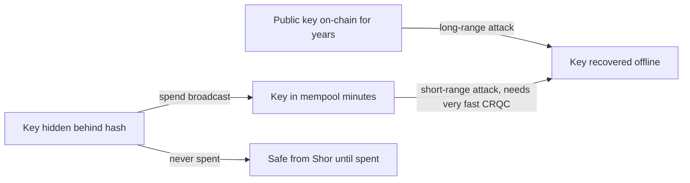

# The Quantum Threat Model for Blockchains

A large, fault-tolerant quantum computer would break the signature schemes that nearly every blockchain uses today. Nobody has built one, estimates of when one might exist vary widely, and migration of a decentralised system takes years. This chapter explains what quantum algorithms actually threaten, what they do not, and how to reason about timelines without hype.

## Two algorithms that matter

| Algorithm | Problem it speeds up | Effect on blockchains |
|---|---|---|
| Shor (1994) | integer factoring and discrete logarithms, including on elliptic curves | breaks ECDSA (secp256k1, P-256), Schnorr/BIP 340, EdDSA (Ed25519), BLS signatures and pairing-based SNARKs: a public key reveals the private key |
| Grover (1996) | unstructured search, quadratic speedup | weakens hash preimage search from about 2^n to about 2^(n/2) work; SHA-256 preimages remain around 2^128 quantum operations, which is considered safe |

The asymmetry is the whole story. Hashes, Merkle trees, and hash-based commitments survive with at most a parameter bump. Elliptic-curve signatures fail completely once a cryptographically relevant quantum computer (CRQC) exists.

Grover is also often overstated for mining. Its quadratic speedup applies in principle to proof-of-work search, but the slow clock speeds and error-correction overhead of foreseeable quantum hardware make it far from competitive with ASICs.

## What exactly is exposed

Shor needs the **public key**. Many systems hide the public key behind a hash until it is used:

- Bitcoin P2PKH, P2WPKH and P2SH/P2WSH outputs commit to hashes; the public key appears when spending. Pay-to-public-key (P2PK) outputs, common in early coinbase transactions, and Taproot (P2TR) outputs expose a public key directly in the output.
- Reused addresses expose the public key after the first spend.
- Ethereum externally owned accounts expose their public key with their first transaction (it is recoverable from any signature).
- Validator keys in proof-of-stake (often BLS) are public by design.
- Extended public keys (xpubs) shared with services expose every derived public key.

Even hidden keys are exposed briefly: when a transaction is broadcast, its public key sits in the mempool until confirmation. A fast enough quantum attacker could derive the key and race a conflicting transaction. This is the "short-range" attack; it requires much faster quantum computers than attacking long-exposed keys.

## Resource estimates and timelines

Published estimates of the hardware needed have fallen over time as algorithms and error-correction designs improve:

- Roetteler, Naehrig, Svore and Lauter (2017) estimated logical-qubit and gate counts for elliptic-curve discrete logs on 256-bit curves.
- Gidney and Ekerå (2019) estimated factoring RSA-2048 with about 20 million noisy qubits in about eight hours.
- Gidney (2025) revised the RSA-2048 estimate to under one million noisy qubits in under a week.
- Webber et al. (2022) estimated physical qubit counts for breaking Bitcoin's elliptic-curve keys within various time windows.

These are estimates of resources under assumptions about error rates, not predictions of dates. Public quantum machines are orders of magnitude away from these figures in error-corrected qubits. Government guidance nonetheless sets migration deadlines in the 2030s; NIST's draft IR 8547 (2024) proposes deprecating classical public-key algorithms at the 112-bit security level by 2030 and disallowing them by 2035.

The rational planning frame is Mosca's inequality: if the time your data or assets must stay secure plus the time to migrate exceeds the time until a CRQC exists, you are already late. Blockchains have long migration times because they need social consensus, wallet upgrades and user action.

## Threat model summary

| Asset | Threat | Urgency driver |
|---|---|---|
| Coins in exposed-key outputs | long-range key recovery | size of exposed supply, lost coins that cannot migrate |
| Coins in hashed outputs | short-range mempool attack | requires very fast CRQC |
| PoS validator keys | forged votes, slashing manipulation | consensus migration complexity |
| SNARK-based systems (pairings) | forged proofs | proof system replacement |
| Encrypted data stored today | harvest now, decrypt later | data sensitivity lifetime (chapter 6) |

## Worked example

> **Execution status:** not executed in this book's CI. Commands, code and expected results below are written from documentation, not observed output; verify locally.

See a public key become exposed on Bitcoin regtest.

1. Start `bitcoind -regtest`, create a wallet, mine 101 blocks, and get a P2WPKH address with `getnewaddress "" bech32`.
2. Send coins to it and mine a block. Inspect the output with `getrawtransaction <txid> true`: the `scriptPubKey` contains only a 20-byte hash.
3. Spend from that address and mine a block. Decode the spending transaction: the `txinwitness` field contains the signature and the 33-byte compressed public key.
4. Get a P2TR address (`getnewaddress "" bech32m`), fund it and inspect the output: the 32-byte x-only key is visible immediately, before any spend.
5. Record which address types expose keys at receipt, at spend, or never (unspent hashed outputs).

## Common pitfalls

- Saying "quantum breaks Bitcoin" without distinguishing signatures from hashes and mining.
- Treating qubit announcements as directly comparable to error-corrected logical qubits.
- Ignoring that unspent hashed outputs are protected only until spent.
- Forgetting xpubs shared with third parties.
- Using resource estimates as calendar predictions.

## Exercises

1. Extend the regtest exercise to classify every output in the first 200 regtest blocks by exposure type.
2. Apply Mosca's inequality to a hypothetical chain with a 7-year migration estimate and a 15-year asset-security requirement; state your assumptions.
3. Read one of the resource-estimate papers above and summarise the error-rate and cycle-time assumptions behind its headline number.

## Further reading

- Shor, "Algorithms for quantum computation: discrete logarithms and factoring" (1994)
- Roetteler et al., "Quantum resource estimates for computing elliptic curve discrete logarithms" (2017)
- Gidney and Ekerå, "How to factor 2048 bit RSA integers in 8 hours using 20 million noisy qubits" (2019)
- Gidney, "How to factor 2048 bit RSA integers with less than a million noisy qubits" (2025)
- Webber et al., "The impact of hardware specifications on reaching quantum advantage in the fault tolerant regime" (2022)
- NIST IR 8547 (initial public draft, 2024), "Transition to Post-Quantum Cryptography Standards"
