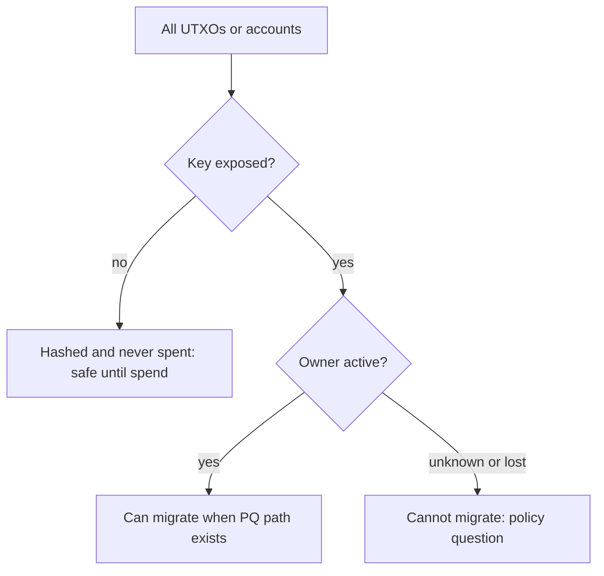

# Measuring Exposed Public Keys

Before deciding how urgent migration is, a chain needs to know how much value sits behind public keys that are already visible. This chapter explains how to classify outputs and accounts by exposure, what public analyses have found, and how to build your own measurement on a local node.

## Exposure classes on Bitcoin

| Output type | Key visible when | Notes |
|---|---|---|
| P2PK | at creation | common in early coinbase outputs, many of which have never moved |
| P2PKH, P2WPKH | at first spend from that address | safe while unspent and unreused |
| P2SH, P2WSH multisig | at first spend (all keys in the script) | reused scripts expose keys |
| P2TR | at creation (output key) | key-path spend uses the exposed key directly |
| Any reused address | after first spend | remaining balance on that address is exposed |
| Shared xpub | whenever the xpub is shared | all derived keys exposed to the holder |

Several public analyses have tried to quantify this. Deloitte published one widely cited analysis (around 2020–2022) concluding that roughly a quarter of bitcoin in circulation was in outputs with exposed public keys, a large part of it in early P2PK outputs and reused addresses. Figures change as coins move and as Taproot adoption grows; reproduce rather than quote.

A hard subset is **lost coins**: P2PK outputs from early miners whose keys may be lost. They cannot migrate, and whoever builds a CRQC first could take them. Whether the protocol should freeze, sunset or leave them is a social question, discussed in chapter 5.

## Exposure on Ethereum and account chains

Account-based chains reveal the public key with every signed transaction, because the signature allows key recovery. So:

- every EOA that has ever sent a transaction is exposed;
- EOAs that have only received funds are not (the address is a hash of the key);
- contract accounts have no key; their security depends on their own logic and on their owners' keys;
- EIP-7702 delegated EOAs still have their original key, which can still sign.

In practice, almost all value held directly by active EOAs is exposed. Value in smart contract wallets depends on the owners' keys, which are usually EOAs that have transacted. Validator BLS keys are public by design.

## What exposure does not tell you

- **Time to attack.** A CRQC would likely need substantial time per key at first; attackers would prioritise large balances.
- **Migratability.** Exposed coins with active owners can move to new outputs once a PQ option exists. Lost coins cannot.
- **Short-range exposure.** Hashed outputs become exposed in the mempool on spend.



## Methodology for your own measurement

1. Scan the UTXO set (Bitcoin) or account state (Ethereum).
2. Classify each output by script type.
3. For hashed types, determine whether the same script has ever been spent from (address reuse) by indexing all historical inputs.
4. Sum values per class and per age bucket (last movement).
5. Publish the method and code with the numbers so others can reproduce them.

For Bitcoin mainnet you need a full node and enough disk to index inputs; Bitcoin Core's `dumptxoutset` and `scantxoutset` help with the UTXO set, and block parsing tools help with the history. Start on regtest or signet to build and test the classifier.

## Using AI assistance

An LLM can help write a script classifier or explain an unusual script. It must not be the classifier. Validate the script against hand-labelled test vectors (one of each script type built on regtest) and treat any disagreement as a bug to resolve by reading the script bytes.

## Worked example

> **Execution status:** not executed in this book's CI. Commands, code and expected results below are written from documentation, not observed output; verify locally.

Build an exposure classifier on regtest.

1. Start `bitcoind -regtest -txindex=1`, create a wallet, and mine 101 blocks.
2. Create one output of each type: P2PKH (`getnewaddress "" legacy`), P2WPKH (`bech32`), P2TR (`bech32m`), a 2-of-2 P2WSH (with `createmultisig 2 '["pk1","pk2"]' bech32`), and a P2PK output with script `<33-byte pubkey> OP_CHECKSIG`, built with a library such as `python-bitcoinlib` because Bitcoin Core's wallet does not create P2PK outputs directly.
3. Reuse one P2WPKH address: receive twice, spend once.
4. Write a Python script using the RPC (`getblock <hash> 2`) that walks all blocks, records spent scripts from `vin` prevouts, and classifies current UTXOs from `scantxoutset` or `listunspent` as exposed or hidden:

```python
EXPOSED_AT_CREATION = {"pubkey", "witness_v1_taproot"}
def exposed(utxo_type, script_hex, spent_scripts):
    return utxo_type in EXPOSED_AT_CREATION or script_hex in spent_scripts
```

5. Check the output against your hand-made list from steps 2–3. Every UTXO should match. Note that this script was written for this book and should be tested by you before use on real data.

## Common pitfalls

- Quoting old exposure figures as current.
- Missing address reuse because only the UTXO set was scanned.
- Treating Taproot outputs as hashed.
- Ignoring xpubs held by services.
- Counting contract wallets as safe without checking their owners' keys.

## Exercises

1. Extend the classifier to bucket exposed value by last-movement age, and add a test for each bucket.
2. On an Ethereum local devnet (Anvil), send transactions from some accounts and not others, then write a script that recovers public keys from signatures and lists exposed accounts.
3. Run the classifier on signet and publish the method, code and numbers with the date.

## Further reading

- Bitcoin Core RPC: `scantxoutset`, `dumptxoutset`, `getblock`: <https://developer.bitcoin.org/reference/rpc/>
- Deloitte, "Quantum computers and the Bitcoin blockchain" (analysis article)
- BIP 341 (Taproot output keys): <https://github.com/bitcoin/bips/blob/master/bip-0341.mediawiki>
- Ethereum Yellow Paper, transaction signatures and key recovery
- See **onchain-malware-analysis** for chain-data tooling
